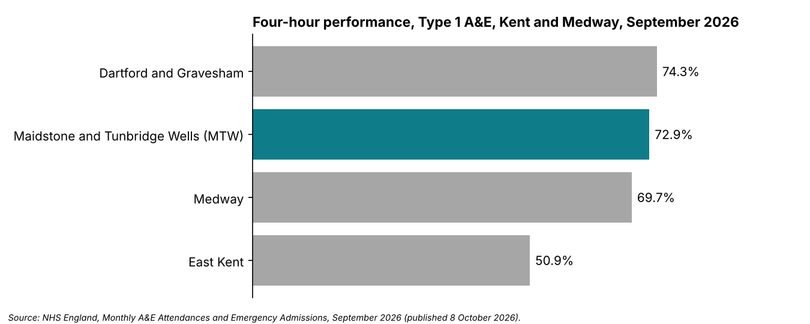

# Project 1: A&E four-hour performance, Kent and Medway (September 2026)

## The question
How did Maidstone and Tunbridge Wells NHS Trust (MTW) perform against the four-hour A&E standard in September 2026, and how does it compare with the other acute trusts in Kent and Medway?

## Data
NHS England, *A&E Attendances and Emergency Admissions*, September 2026 (published 8 October 2026), the "by provider" file. Public data. No patient-level or Trust data is used anywhere in this project.

## What I did
1. Cleaned the provider sheet into a table (`AE_Clean`): removed the England total row and blank row, trimmed trailing spaces, and added each provider's ICB from the mapping sheet.
2. Calculated all-types and Type 1 four-hour performance for every provider.
3. Built a `Summary` sheet that looks up any provider by ODS code using XLOOKUP (set to RWF for MTW).
4. Built a PivotTable for the Kent and Medway ICB with calculated fields for Type 1 and all-types percentages, and filtered to providers that have Type 1 attendances.
5. Made one chart and wrote a one-page glossary of the terms I met.

## Data traps I found
- The source sheet has an England total row and a blank row above the providers.
- Region names have trailing spaces, which break filters and lookups.
- The ICB mapping sheet contains duplicate organisation codes, so a plain join returns more rows than there are providers.
- Some providers (GP-led walk-in and community services) have no Type 1 attendances, so a Type 1 percentage cannot be calculated for them.

## Findings
- MTW saw **72.9%** of Type 1 attendances within four hours.
- That ranks **second of four** Kent and Medway acute trusts, behind Dartford and Gravesham (74.3%) and ahead of Medway (69.7%) and East Kent (50.9%).
- Across all attendance types, MTW was 74.9%, against 74.4% nationally.

**Reading the pivot totals:** the pivot grand total (84,148 attendances, 75.2% all types) covers only the four providers with Type 1 departments, because the others were filtered out. It is not the Kent and Medway ICB total (79.3% all types, which includes the walk-in and community services).

## Caveats
This is a single month, so it shows a snapshot, not a trend. Type 1 and all-types figures answer different questions, and comparing a hospital A&E with a walk-in centre is not a fair comparison.

## Tools
Excel (tables, XLOOKUP, PivotTable with calculated fields, charts).

## Files
- [`ae_analysis_sep2026.xlsx`](ae_analysis_sep2026.xlsx): the complete Excel analysis workbook
- [`glossary.md`](glossary.md): one-page glossary of NHS terms
- [`imgs/chart_kent_type1.png`](imgs/chart_kent_type1.png): the four-hour performance chart
- [`data/September-26-AE-by-provider-B5lUR.xls`](data/September-26-AE-by-provider-B5lUR.xls): original NHS England raw data file

## Next
Project 1 repeats the analysis in SQL Server (Weeks 2 and 3) and then adds 12 months of data in Power BI.
